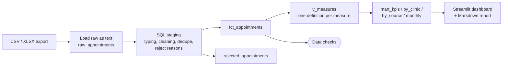

# Clinic Data Intelligence

A small, tested data project for multi-clinic appointment data: a **SQL pipeline** that loads, cleans and
validates an export, builds reporting tables, and a **Streamlit dashboard** on top. All data is synthetic.

**Problem it solves:** a practice manager needs to see where revenue leaks (cancellations, no-shows, unpaid
visits) and which marketing channels bring patients who actually attend, and needs to know when the numbers
can't be trusted. Every rejected row is listed with a reason, and every KPI is defined in one place.

<!-- TODO: add a screenshot of the running app as docs/screenshot.png, then uncomment:
 -->

## How it works



| Layer | Where | What it does |
|---|---|---|
| Load | `clinic_agent/warehouse.py` | Stores every value as untouched text with its row number in the file |
| Staging | `sql/01_stg_appointments.sql` | Parses dates and amounts, merges spelling variants, de-duplicates, assigns a reject reason |
| Facts | `sql/02`–`03` | `fct_appointments` (valid rows) and `rejected_appointments` (everything else, with reasons) |
| Measures | `sql/04_v_measures.sql` | Single definition of completed, cancelled, no-show, billed, collected, outstanding |
| Marts | `sql/05`–`08` | KPIs overall, by clinic, by marketing source, by month |
| Checks | `sql/checks/` | Unique IDs, required fields, non-negative amounts, valid status groups, row-count reconciliation |

The same cleaning and KPI logic also exists as an independent pandas implementation (`clinic_agent/cleaning.py`,
`kpis.py`) that powers the dashboard. **The test suite checks that the SQL results equal the pandas results**
on both sample files, so each implementation validates the other.

## Run it

```bash
python -m venv .venv
source .venv/bin/activate          # Windows: .venv\Scripts\activate
pip install -r requirements.txt

# 1. SQL pipeline (needs only the standard library + pandas)
python -m clinic_agent.pipeline --input sample_data/clinic_appointments_messy.csv --db warehouse.db

# 2. Dashboard
streamlit run app.py

# 3. Tests (20)
python -m unittest discover -s tests -v
```

The pipeline prints how many rows loaded and were rejected (with reasons), which checks passed, and the KPIs.
`sample_data/clinic_appointments_messy.csv` has duplicates, impossible dates, `$1,200`-style amounts, a negative
amount, a missing clinic and an unrecognised status, so you can see the checks working.

## Input columns

Required: `appointment_id`, `clinic`, `appointment_date`, `status`, `billed_amount`, `collected_amount`.
Optional: `patient_id`, `marketing_source`. Common alternative headers are recognised (see `config.py`).
Dates: ISO (2025-03-01) or day-first (03/04/2025).

## Metric definitions

Defined once in `clinic_agent/config.py` (status groups) and `sql/04_v_measures.sql`.

- **Completed:** `completed`, `complete`, `attended`, `done`. **Cancelled:** `cancelled`, `canceled`. **No-show:** `no-show`, `no show`, `noshow`
- **Billed / collected:** completed appointments only
- **Outstanding:** per-visit shortfall (billed minus collected, never below zero), summed, so an overpayment
  on one visit cannot hide an unpaid balance on another
- **Lost rate:** (cancelled + no-shows) / all appointments

These are demonstration definitions. A real deployment would confirm them with the finance lead
(refunds, partial payments, GST, reschedules).

## Design decisions

- **Raw data is never altered.** Cleaning happens in SQL on a copy, so any number can be traced to a file row.
- **Rejected rows are reported, not dropped silently.**
- **Two implementations, one answer.** The reconciliation tests caught a real bug during development:
  ISO dates were being read day-first, which shifted every month. Tests now guard that case.
- **Portable SQL.** The models use plain SQL on SQLite so there is nothing to install. They are written to port
  to a cloud warehouse with small changes (date parsing and regex functions differ).

## How this could map to a cloud stack (not implemented here)

| This project | Cloud equivalent |
|---|---|
| SQLite | BigQuery |
| `sql/*.sql` models and `sql/checks/` | Dataform models and assertions |
| `load_raw()` | An ingestion tool such as dlt |
| `python -m clinic_agent.pipeline` | A scheduled container job (e.g. Cloud Run) |
| Streamlit dashboard | Looker Studio |

## Limitations

- Synthetic data, 20 and 22 rows. It demonstrates correctness, not scale.
- SQL date parsing supports ISO and `dd/mm/yyyy` only; the pandas path accepts more formats.
- No authentication, access control or audit logging. Do not load real patient data.

## How AI tools were used

This project was built with AI assistance (Claude). I reviewed the generated code, ran it, and rely on the
test suite to confirm the SQL and pandas implementations agree. AI output is treated as a draft that must
pass the tests, not as a source of truth.

## Project structure

```text
├── app.py                       # Streamlit dashboard
├── clinic_agent/                # config, cleaning, kpis, insights, report, warehouse, pipeline
├── sql/                         # numbered SQL models + checks/
├── tests/                       # 20 tests (pandas logic and SQL/pandas reconciliation)
├── sample_data/                 # clean and messy synthetic files
├── build_preview.py             # builds docs/preview.html (static dashboard preview)
└── .github/workflows/tests.yml  # runs the tests on every push
```

## Privacy

Use synthetic or de-identified data only. Do not upload names, contact details, dates of birth or health
information.

## Licence

MIT
